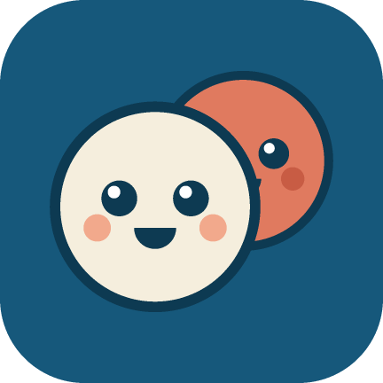
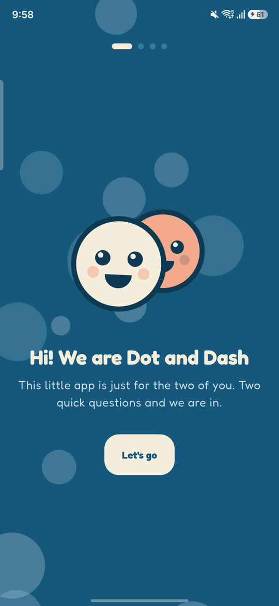
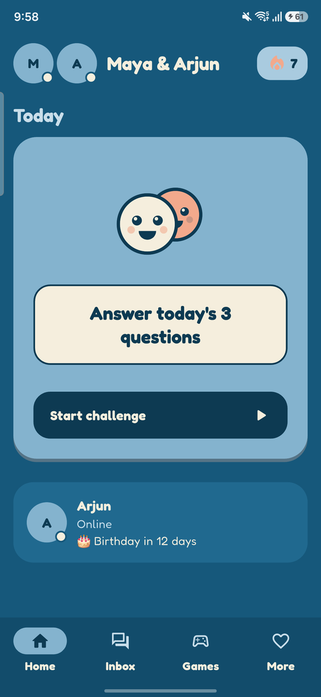
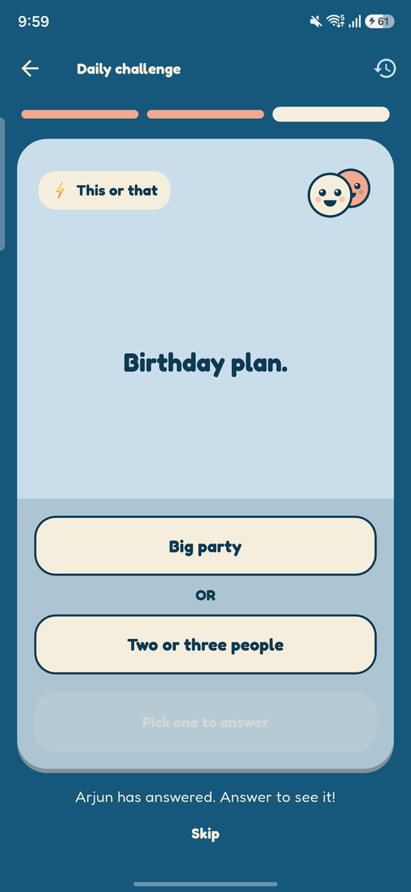
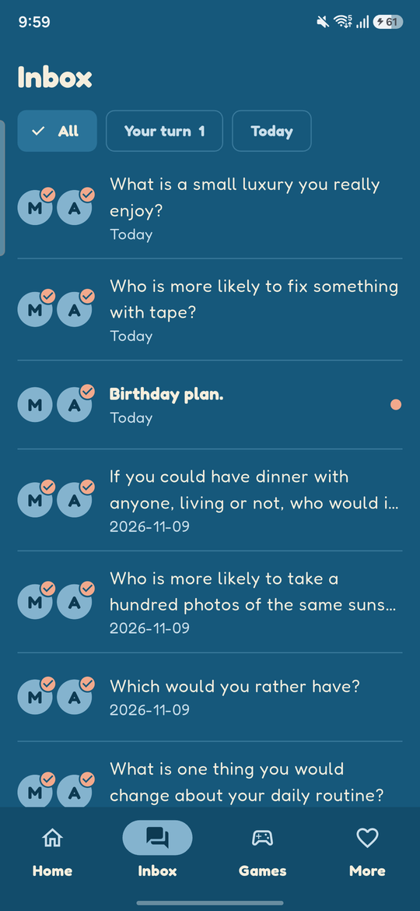
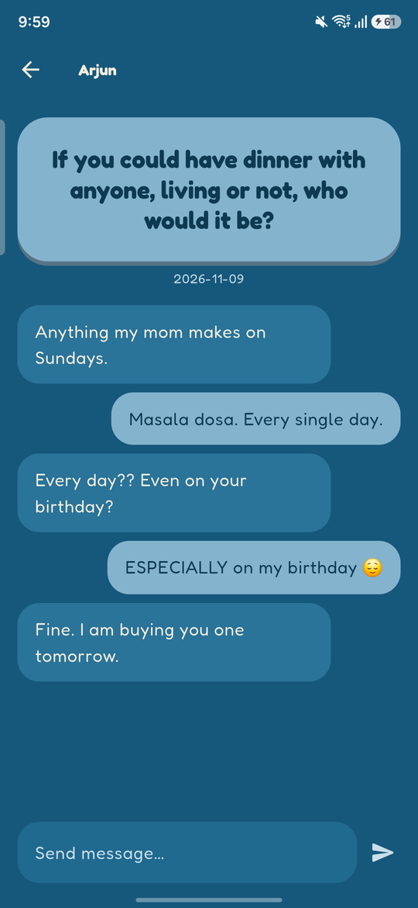
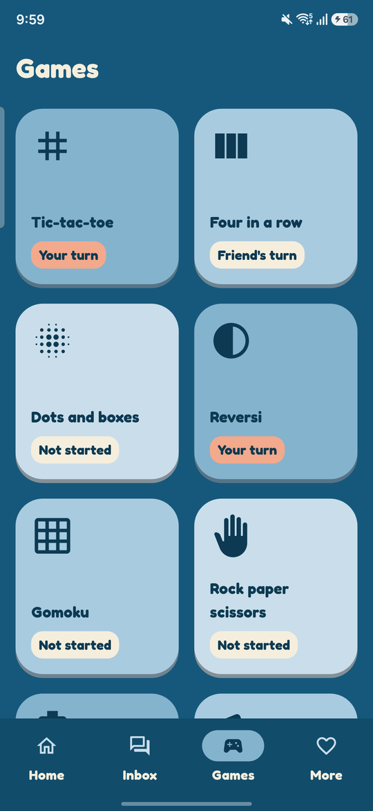
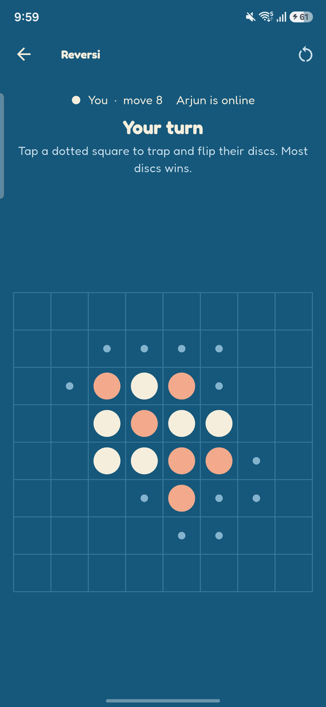
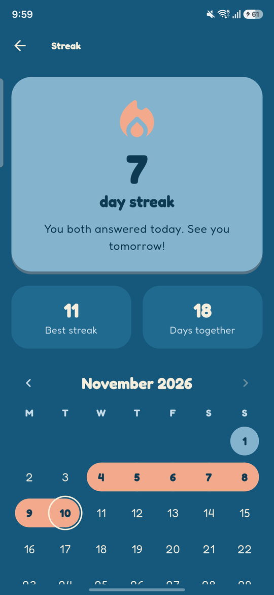

<p align="center"></p>

# Duet

<p align="center">
  <a href="https://github.com/Nuu-maan/duet/actions/workflows/ci.yml"></a>
  <a href="LICENSE"></a>
  
  
  
</p>

A small, private Android app for two people: a couple, best friends, or anyone long-distance.
You answer three questions a day, keep a streak going, play turn-based games and share a couple of lists.

Duet is free and open source. You host it yourself on Firebase's free plan, so your answers and photos live in
a database only the two of you can read. There are no ads, no subscription, no analytics and no account system
beyond Google sign-in.

It is an open-source alternative to paid couple apps such as Lovora. Duet is an independent project and is not
affiliated with any of them.

## Screenshots

<p align="center">
  
  
  
  
</p>
<p align="center">
  
  
  
  
</p>

<p align="center"><sub>Welcome · Home · Daily challenge · Inbox<br>Question thread · Games · Reversi · Streak calendar</sub></p>

The people and answers shown are made up.

## Features

- **Daily challenge.** Three questions every day, the same on both phones: one to answer in your own words, one
  "who is more likely", one "this or that". Your partner's answer stays hidden until you answer.
- **Inbox.** Every answered question becomes a thread with both answers and a chat underneath.
- **Streak.** Goes up each day you both answer at least one question.
- **Ten two-player games.** Tic-tac-toe, four in a row, dots and boxes, reversi, gomoku, rock paper scissors,
  battleship, memory match, checkers and hangman. Turn-based, so you can play across time zones.
- **Shared lists.** A bucket list and countdowns to dates that matter.
- **Profiles.** Name, birthday and a profile photo; see when the other person is online.
- **Notifications (optional).** Streak reminders, "your friend answered", chat messages and game turns, with
  wording that changes every time. You can even write your own reminder lines for the other person.
- **Light.** No bundled images or video. Boards and the mascot are drawn in code, and the app stays smooth on
  low-end phones.

## How it works

Duet is built for exactly two people who share one Firebase project.

| Piece | What it does |
|---|---|
| Google sign-in | Identifies each of you |
| Realtime Database | Stores answers, games, lists and presence under `/pair` |
| Database rules | Allow only your two account IDs; everyone else sees "Not allowed" |
| Cloudflare Worker (optional) | Sends push notifications |

Apart from the optional notification Worker, there is no server to run, and nothing to pay for. Each pair hosts their own copy, so no one else, including the
people who wrote Duet, can see your data.

## Host it yourself

It takes about 20 minutes. You need a computer, a Google account and two Android phones (Android 7 or newer).

### 1. Install the tools

- [Flutter](https://docs.flutter.dev/get-started/install) (stable channel, 3.47 or newer)
- JDK 17
- Android SDK (it comes with Android Studio, or install the command-line tools)

Run `flutter doctor` and fix anything it flags for Android.

### 2. Get the code

```sh
git clone https://github.com/Nuu-maan/duet.git
cd duet
flutter pub get
```

### 3. Create a Firebase project

1. Open the [Firebase console](https://console.firebase.google.com) and create a project. Turn Google
   Analytics off. Stay on the free Spark plan; Duet never needs billing.
2. Add an **Android app** with the package name `dev.duet.app`.
3. Paste the SHA-1 of your signing key (Google sign-in fails without it). For the default debug key:

   ```sh
   keytool -list -v -alias androiddebugkey -storepass android \
     -keystore ~/.android/debug.keystore
   ```

   On Windows the keystore is at `%USERPROFILE%\.android\debug.keystore`.
4. Go to **Build > Authentication > Sign-in method** and enable **Google**.
5. Go to **Build > Realtime Database** and create a database in **locked mode**.
6. Go to **Project settings > Your apps**, download `google-services.json` and put it in `android/app/`.
   Download it after the steps above, so it includes the sign-in client and the database address.

`google-services.json` is in `.gitignore`. Keep it out of any public fork.

### 4. Build and install

```sh
flutter build apk --release --split-per-abi
```

Install `build/app/outputs/flutter-apk/app-arm64-v8a-release.apk` on both phones. Almost every phone from the
last several years is arm64; use the `armeabi-v7a` file for older 32-bit phones.

To install straight from the computer over USB, turn on USB debugging on the phone and run
`flutter run --release`.

Both phones must use an APK signed with the key whose SHA-1 you registered. The simplest way is to build once
and send the same file to both.

### 5. Let the two of you in

1. Both of you open the app and sign in with Google. You will each see **Not allowed**. That is expected: the
   database is still locked.
2. In the Firebase console, open **Authentication > Users** and copy the two **User UID** values.
3. Open `database.rules.json`, replace `UID_ONE` and `UID_TWO` with them, and paste the whole file into
   **Realtime Database > Rules**. Click **Publish**.
4. Reopen the app on both phones. You will go through a short welcome, then land on Home.

That's it. Answer today's questions and start a game.

### 6. Notifications (optional)

The app works without this step; you just get no notifications. Turning them on takes one small server, a
Cloudflare Worker on the free plan (no card), because Firebase's free plan cannot run server code.

Every notification is decided on the server from live data, right before it is sent, so nobody is reminded about a
streak they already saved.

| Notification | When |
|---|---|
| Daily nudge | 7 pm your time, if you have not answered |
| Streak about to end | 9:30 pm, if a streak is alive and you have not answered |
| Your friend is waiting | When they answer and you have not |
| Streak milestone | At 2, 7, 14, 30, 50, 100 and 365 days |
| Friend answered / sent a message | Straight away |
| Your turn in a game | Straight away |
| Birthday and countdown reached | 9 am on the day |

Nothing is sent between 11 pm and 8 am. Each group can be switched off in the app's Settings.

1. Create a free account at [cloudflare.com](https://www.cloudflare.com) and install Node.js.
2. In the Firebase console, open **Project settings > Service accounts** and click **Generate new private key**.
   Save the file outside the project. It gives full access to your Firebase project: never commit or share it.
3. Open `worker/wrangler.toml` and fill in `DB_URL` and `WEB_API_KEY`. Both are in your `google-services.json`.
4. Deploy and store the key:

   ```sh
   cd worker
   npx wrangler login
   npx wrangler deploy
   npx wrangler secret put SERVICE_ACCOUNT   # paste the whole key file, on one line
   ```

5. Open the Worker's address (printed by `deploy`) once in a browser. It saves its address in your database so
   the app can find it.
6. Open the app on both phones and allow notifications.

Changing the wording or the times means editing `worker/src/rules.js` and running `npx wrangler deploy` again; the
app does not need an update.

Some phones delay notifications for apps they consider idle. If they arrive late, set the app's battery usage to
"Unrestricted" in Android settings.

### Updating later

Pull the latest code, rebuild and install the new APK over the old one. Your data stays in Firebase.

If you want to push fixes to both phones without reinstalling, Duet works with
[Shorebird](https://shorebird.dev) code push, which has a free tier. Run `shorebird init`, then build with
`shorebird release android --artifact apk -- --no-tree-shake-icons` instead of `flutter build apk`.

## Privacy and limits

- The database rules are the only thing protecting your data. Do not skip step 5, and do not share your
  two UIDs' access with anyone else.
- "Hidden until you answer" is enforced by the app, not the database. Both of you can technically read each
  other's answers and game state from the Firebase console. Duet assumes the two of you trust each other.
- Profile photos are shrunk to 256 px and stored in the database (the free plan has no file storage).
- Android only. One pair per Firebase project.
- The day changes at each phone's local midnight. Two phones in different time zones can briefly show
  different questions around midnight.

## Development

```sh
flutter analyze
flutter test
(cd worker && node --test)   # notification rules
flutter run --release   # performance is only meaningful in release mode
```

To try things without touching your real data, build with `--dart-define=DUET_ROOT=demo`. The app then reads and
writes under `/demo` instead of `/pair`; add a matching `demo` block to your database rules first.

The project builds without `google-services.json`; the app then shows a "Firebase is not set up" screen. That
is enough for working on UI and game rules, and it is what CI does.

```
lib/
  main.dart               app entry, theme, auth gate
  theme.dart              colours, shapes, type
  art.dart                mascot and icons drawn in code
  pair.dart               members, presence, avatars
  daily.dart              question bank, answers, streak, inbox, chat (pure logic + database calls)
  daily_screen.dart       the daily challenge cards
  inbox_screen.dart       inbox and question threads
  games/                  game interface, room, one file per game
  lists.dart, lists_screen.dart
  settings_screen.dart, onboarding_screen.dart, home_screen.dart, sign_in_screen.dart
  notifications.dart      registers the phone for pushes, tells the server about events
worker/                   optional Cloudflare Worker that decides and sends notifications
assets/questions.json     the question lists
database.rules.json       rules template
test/                     unit tests for every game's rules and the daily logic
```

More detail is in [docs/ARCHITECTURE.md](docs/ARCHITECTURE.md).

## Contributing

Pull requests are welcome: new games, more questions, translations, bug fixes. Read
[CONTRIBUTING.md](CONTRIBUTING.md) first; it is short. Please also read the [code of conduct](CODE_OF_CONDUCT.md), and report
security problems privately as described in [SECURITY.md](SECURITY.md).

Good first contributions:

- Add questions to `assets/questions.json`
- Add a game (each one is a single file plus tests; see `lib/games/tic_tac_toe.dart`)
- A ship-placement screen for battleship

## License

Code is released under the [MIT License](LICENSE).

The Fredoka typeface in `assets/fonts/` is licensed under the
[SIL Open Font License 1.1](assets/fonts/OFL.txt).
